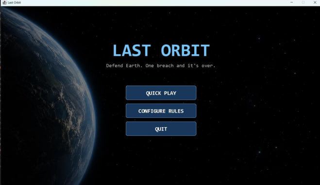
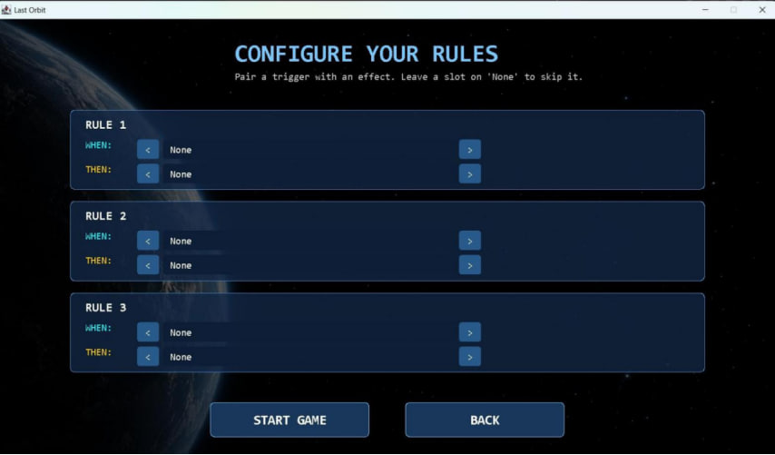
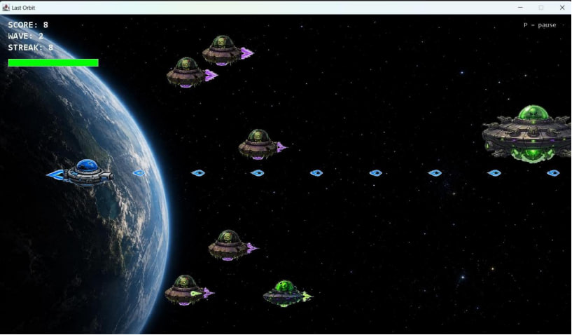

# 🚀 Last Orbit

**A 2D space shooter built from scratch in pure Java:**

> 🎓 **Object-Oriented Programming school project**: developed for the Object-Oriented Programming course at the University of Messina.

Alien UFOs are descending on Earth, and you are the last line of defense. Pilot your ship, blast the invaders, take down the bosses, and, before the battle even starts, **design your own rules** that decide how the game reacts to your performance.






---

## ✨ Features

- **Fast arcade gameplay**: your ship is fixed on the left, moves up and down, and fires automatically.
- **Four enemy types**
  - **Standard**: light and fast to destroy.
  - **Armored**: takes multiple hits, shoots back, and visibly deteriorates as it takes damage.
  - **Mini**: quick shooters, spawned in numbers by the boss.
  - **Boss**: patrols the screen, fires at you, and spawns minis. It drops a power-up when destroyed.
- **Wave system** with a difficulty controller that adapts to how well you are doing.
- **Boss power-ups**: Shield, Alien Freeze, and Spread Weapon, applied to your ship at runtime.
- **Custom rule engine**: build up to three *WHEN → THEN* rules before you play.

  | WHEN (trigger) | THEN (effect) |
  |---|---|
  | Kill streak of *N* | Gain a shield (*N* hits) |
  | Health drops to *N* | Heal health |
  | Alien crosses halfway | Freeze all aliens |
  | A boss is on screen | Wipe all aliens |
  | | Spawn a boss |

- **Persistent high scores**: the top five are saved to a text file between sessions.
- **Pause menu**, animated sprites, sound and music.

---

## 🎮 Controls

| Action | Input |
|---|---|
| Move up / down | `W` / `S` or `↑` / `↓` |
| Fire | Automatic |
| Pause / resume | `P` or `Esc` |
| Menus | Mouse |
| Enter high-score name | Letters / digits, `Enter` to confirm |

---

## 🛠️ Build & Run

**Requirements:** JDK 17 or newer. Nothing else.

From the project root (so the `resources/` folder resolves):

```bash
# Compile
javac -d bin -cp src src/lastorbit/Main.java

# Run
java -cp bin lastorbit.Main
```

On Windows, use backslashes in the source path if your shell requires it:

```
javac -d bin -cp src src\lastorbit\Main.java
```

> **Important:** run both commands from the project root. Sprites, sounds and the high-score file are loaded with relative paths such as `resources/sprites/...`.

---


## 👤 Author

**Robel Teshome Eshete**
Object-Oriented Programming course project, University of Messina.
